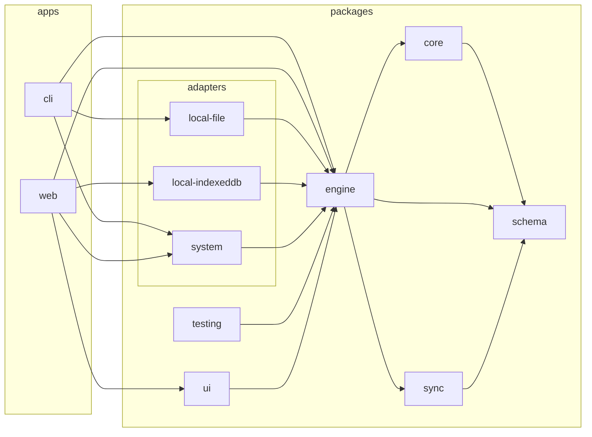
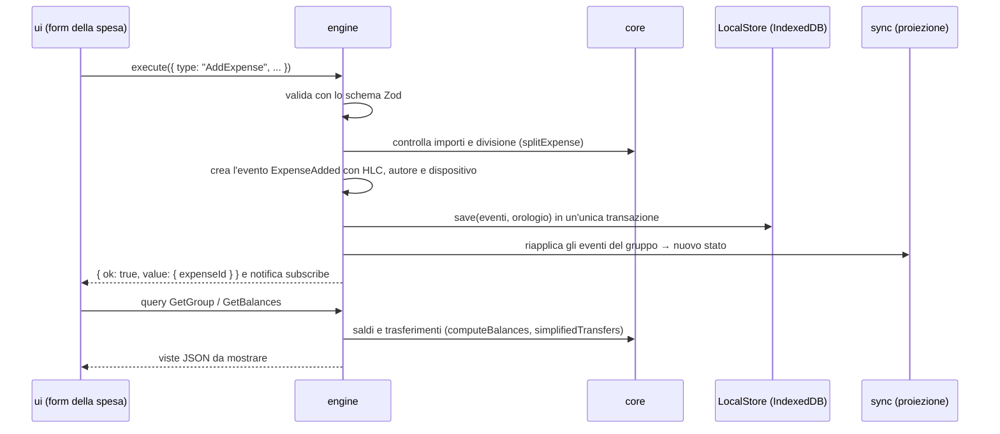
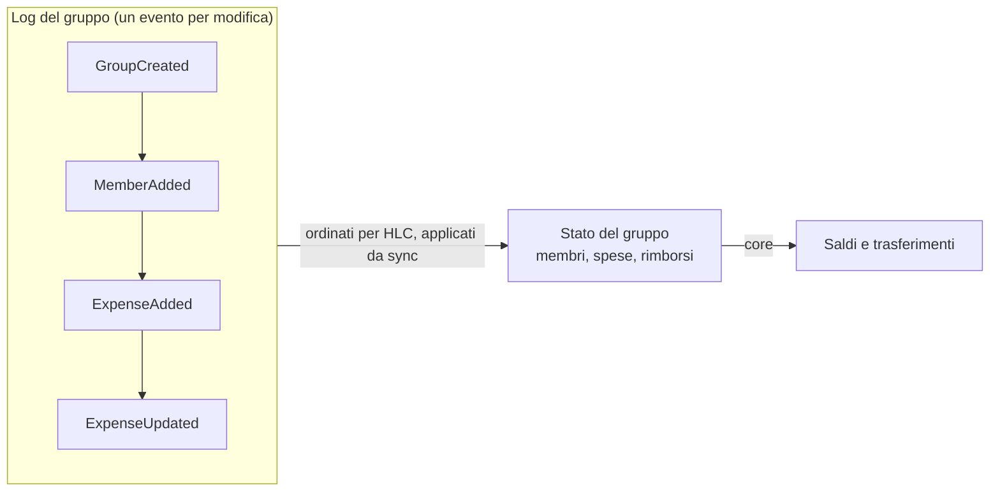

# Architettura

Come è fatto ExpenseCalcolator oggi (Fase 3 completata): pacchetti, flusso dei dati, modello a eventi,
piattaforme e controlli automatici. Il perché delle scelte e il piano dei lavori stanno in
[PLANNING.md](PLANNING.md) e negli [ADR](adr/); questo documento descrive il sistema così come è costruito.

## In breve

- **Local-first.** Ogni dispositivo ha la copia completa dei propri gruppi e funziona offline. Non c'è un
  server né un database centrale: la condivisione passerà dai file dei canali (Fasi 5 e 6).
- **Un solo linguaggio, TypeScript, su ogni piattaforma** ([ADR 0001](adr/0001-linguaggio-typescript.md)): la
  stessa logica gira nella web app, nella CLI e, dalla Fase 4, nelle app native.
- **Architettura esagonale (porte e adapter).** Il cuore (`schema`, `core`, `sync`, `engine`) non sa su quale
  piattaforma gira. Salvataggio, orologio e id arrivano dall'esterno attraverso le porte.
- **Event sourcing.** Ogni modifica è un evento immutabile; lo stato si ricostruisce applicando gli eventi
  nello stesso ordine su ogni dispositivo ([ADR 0007](adr/0007-salvataggio-e-concorrenza.md)).
- **Una sola API pubblica:** `engine`. UI e CLI non vedono `core` né `sync`.

## Strati e pacchetti

```text
 Shell            apps/web (browser)      apps/cli (Node)      apps/native (Tauri, Fase 4)
                      │                       │
 Presentazione    packages/ui (React)         │ (testo nel terminale)
                      └───────────┬───────────┘
                                  ▼  solo l'API pubblica
 API pubblica     packages/engine   ◄── packages/adapters/*: IndexedDB, file JSON, orologio e id
                      │      │            packages/channels/*: canali di condivisione (Fase 5)
                      ▼      ▼
 Logica pura      packages/core      packages/sync
                      │      │
                      ▼      ▼
 Modelli dati     packages/schema
```

| Pacchetto                  | Responsabilità                                                                                    | Dove gira         |
| -------------------------- | ------------------------------------------------------------------------------------------------- | ----------------- |
| `schema`                   | Forma dei dati con Zod: id, importi, divisioni, eventi, comandi e query, file di scambio          | ovunque           |
| `core`                     | Calcolo puro: importi interi, ripartizione col resto maggiore, saldi, trasferimenti               | ovunque           |
| `sync`                     | Orologio logico (HLC), ordine degli eventi, proiezione eventi → stato, ultima modifica per campo  | ovunque           |
| `engine`                   | API pubblica: comandi, query, notifiche, scambio di eventi e file; definisce le porte             | ovunque           |
| `adapters/local-indexeddb` | Salvataggio su IndexedDB                                                                          | browser e WebView |
| `adapters/local-file`      | Salvataggio su un file JSON, con scrittura atomica                                                | Node (CLI)        |
| `adapters/system`          | Orologio di sistema e id ULID                                                                     | ovunque           |
| `testing`                  | Suite di contratto delle porte, usata dai test degli adapter                                      | test              |
| `channels/*`               | Canali di condivisione come plugin ([ADR 0006](adr/0006-canali-plugin.md)); per ora solo i README | dalla Fase 5      |
| `ui`                       | L'app in React con shadcn/ui ([ADR 0008](adr/0008-componenti-ui-shadcn.md))                       | browser e WebView |
| `apps/web`                 | Shell web: collega UI, engine e adapter del browser; build Vite, solo in locale                   | browser           |
| `apps/cli`                 | Riga di comando: l'app completa in modalità locale, senza grafica                                 | Node 22           |

### Dipendenze tra i pacchetti

Il grafico è generato da dependency-cruiser a partire dagli `import` reali (escluso il codice di test). Le
frecce vanno sempre verso il basso: nessun pacchetto dipende da uno strato sopra di lui.

<!-- grafico-dipendenze:inizio (generato: pnpm deps:graph) -->



<!-- grafico-dipendenze:fine -->

Le regole sono in [`.dependency-cruiser.mjs`](../.dependency-cruiser.mjs) e `pnpm deps` le verifica a ogni
controllo. Le principali:

- `schema` non dipende da nessuno; `core` usa solo i tipi di `schema` (`import type`), quindi non ha
  dipendenze a runtime; `sync` usa solo `schema`;
- `engine` non conosce adapter, canali, UI e app;
- un adapter o un canale conosce solo le porte (`engine`) e i tipi (`schema`), mai un altro adapter o canale;
- la UI usa solo `engine` (e `schema`); le app non usano direttamente `core` e `sync`;
- niente moduli di Node in `schema`, `core`, `sync` ed `engine`; niente cicli; il codice non importa i test.

## Il flusso di un comando

Esempio: «Anna registra una cena da 90 € divisa in tre» dalla web app.



- **Comandi e query sono messaggi JSON** validati con Zod; gli errori sono valori (`Result` con un `code`),
  mai eccezioni. La UI li traduce in italiano (`ui/src/messages.ts`).
- **Lo stato cambia solo se il salvataggio riesce.** I comandi passano da una coda e si eseguono uno alla
  volta.
- **Le viste sono JSON puri** (array, non `Map`): potranno passare anche attraverso un worker o un bridge
  nativo senza cambiare contratto.

## Dati: eventi, stato, conflitti



- **Due tipi di log.** Uno per ogni gruppo (gruppo, membri, spese, rimborsi) e uno per il profilo personale
  (impostazioni, gruppi collegati, «chi sono io»), che non si condivide mai
  ([ADR 0005](adr/0005-modalita-uso.md)).
- **Busta degli eventi:** id, log, tipo, versione `v`, HLC, dispositivo, autore (`actor`), versione di
  partenza (`base`) e dati. Il formato è pubblicato come JSON Schema in [`spec/schemas`](../spec/schemas/).
- **HLC (orologio logico ibrido):** `"<ms>:<contatore>:<dispositivo>"`, ordinabile come testo. Dà lo stesso
  ordine su ogni dispositivo anche con orologi non allineati; la UI ne legge anche l'ora per mostrare quando
  un elemento è stato inserito o modificato (`timeOfHlc`).
- **Ultima modifica per campo.** Descrizione, data, ora, categoria e note si risolvono campo per campo; totale,
  pagatori e divisione formano un blocco unico («importi»), che resta sempre coerente. L'eliminazione è un
  campo a parte e vince sulle modifiche; si può ripristinare. Le modifiche contemporanee vengono segnalate.
- **Importi interi** in unità minori con la loro valuta (`{ minor: 9000, currency: "EUR" }`), mai numeri con
  la virgola; il resto dei centesimi si assegna in modo deterministico ([ADR 0004](adr/0004-valute.md)).
- **Eventi sconosciuti** (scritti da versioni più recenti dell'app) si conservano senza applicarli.
- **Permessi:** ogni evento passa da una politica (`Policy`); oggi «tutti possono tutto», predisposta per la
  decisione D13.

## Porte e piattaforme

| Porta         | Cosa chiede l'engine                             | Implementazioni                                              |
| ------------- | ------------------------------------------------ | ------------------------------------------------------------ |
| `LocalStore`  | Leggere e salvare eventi e stato del dispositivo | IndexedDB (web, app native), file JSON (CLI), memoria (test) |
| `Clock`       | Ora corrente                                     | Di sistema; manuale nei test                                 |
| `IdGenerator` | Id univoci e ordinabili                          | ULID di sistema; sequenziali nei test                        |
| `SyncChannel` | Trasportare segmenti di eventi (Fase 5)          | Plugin in `packages/channels/`                               |

Ogni shell apre l'engine con gli adapter della propria piattaforma:

- **web** (`apps/web/src/main.tsx`): IndexedDB, orologio e ULID di sistema, richiesta di storage persistente,
  poi `<App engine={engine} />`;
- **CLI** (`apps/cli/src/main.ts`): file JSON nella cartella dell'utente;
- **app native** (Fase 4): la stessa build della web app dentro Tauri, caricata dai file locali.

Il passaggio manuale di un gruppo tra dispositivi usa il **file di scambio** (`ExchangeFile`: gli eventi del
gruppo), uguale per web app e CLI. Importarlo più volte non crea doppioni.

## Interfaccia

- **React + Vite, componenti shadcn/ui** su Tailwind CSS 4, tema chiaro e scuro come il sistema.
- **Collegamento all'engine** con `useSyncExternalStore`: i risultati delle query restano in memoria finché
  l'engine non notifica un cambiamento (`ui/src/engine/store.ts`).
- **Navigazione con l'hash** (`#/gruppi/…`): funziona da file locali e nelle WebView senza configurare un
  server ([ADR 0009](adr/0009-distribuzione-locale.md)).
- **Nessuna logica di dominio nella UI:** prepara i dati dei form, filtra e ordina gli elenchi, formatta
  importi e date; calcoli e regole restano nell'engine.

Le schermate sono descritte nel [README di `packages/ui`](../packages/ui/README.md).

## Qualità e controlli automatici

`pnpm check` è il comando unico, lo stesso della CI: formattazione (Prettier), lint (ESLint), tipi
(TypeScript), confini tra pacchetti (dependency-cruiser, compreso il grafico qui sopra), test con copertura e
build della web app. La CI esegue in più i test E2E (`pnpm e2e`).

| Livello               | Cosa verifica                                                                 | Dove                              |
| --------------------- | ----------------------------------------------------------------------------- | --------------------------------- |
| Unitari e test vector | Calcolo al centesimo, anche contro casi scritti a mano in `spec/test-vectors` | `packages/core`                   |
| Property-based        | Invarianti del calcolo e convergenza di più dispositivi simulati              | `packages/core`, `sync`, `engine` |
| Contratto delle porte | Ogni `LocalStore` passa la stessa suite                                       | `packages/testing`, `adapters/*`  |
| CLI                   | Comandi come da terminale, con file simulati                                  | `apps/cli/test`                   |
| UI                    | Form, filtri e l'app intera usata come una persona (jsdom)                    | `packages/ui/test`                |
| E2E                   | Build vera in un browser vero: offline, riapertura, esporta e importa         | `apps/web/e2e`                    |

Regole che il lint impone oltre ai set ufficiali: niente `Date.now()`, `new Date()` o `Math.random()` nei
pacchetti condivisi (passano dalle porte), tipi espliciti nelle loro API, `switch` completi sulle unioni.

## Dove si trovano le decisioni

| ADR                                           | Decisione                                               |
| --------------------------------------------- | ------------------------------------------------------- |
| [0001](adr/0001-linguaggio-typescript.md)     | TypeScript per tutto il progetto                        |
| [0002](adr/0002-framework-ui-react.md)        | React + Vite per la UI                                  |
| [0003](adr/0003-schema-validazione-zod.md)    | Zod per schemi e validazione, JSON Schema generato      |
| [0004](adr/0004-valute.md)                    | Valuta esplicita in ogni importo, conversione rimandata |
| [0005](adr/0005-modalita-uso.md)              | Tre modalità d'uso con un solo meccanismo               |
| [0006](adr/0006-canali-plugin.md)             | Canali di condivisione come plugin                      |
| [0007](adr/0007-salvataggio-e-concorrenza.md) | Eventi, HLC, ultima modifica per campo, conflitti       |
| [0008](adr/0008-componenti-ui-shadcn.md)      | shadcn/ui con Tailwind CSS                              |
| [0009](adr/0009-distribuzione-locale.md)      | Web app solo in locale, dentro le app native            |

## Prossime evoluzioni

- **Fase 4:** app per Windows e Android con Tauri, che caricano la stessa build della UI dai file locali.
- **Fasi 5 e 6:** porta `SyncChannel` e primi canali (file condiviso, cartella sincronizzata, poi cloud),
  storico delle singole modifiche, condivisione tra persone.
- **Fase 7:** più valute e conversione, grafici, permessi e firme dei dispositivi.

Il dettaglio è nella [roadmap di PLANNING](PLANNING.md#11-roadmap).
